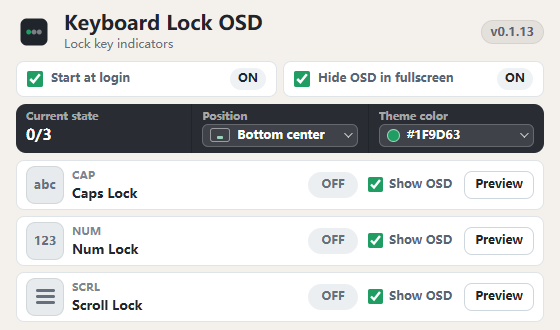

# Keyboard Lock OSD

[简体中文](./README.zh-CN.md)

Keyboard Lock OSD is a lightweight Windows utility that shows a compact on-screen indicator for Caps Lock, Num Lock, and Scroll Lock changes. It stays in the system tray, reacts immediately to lock-key input, and keeps the current state visible across single-monitor and multi-monitor setups without interrupting your typing flow.

## Download

[Download the latest Windows release](https://github.com/coderDJing/keyboard-lock-osd/releases/latest). Open the latest release and download the Windows `.exe` installer.

## Screenshots

### Caps Lock OSD Overlay


### Settings Window



## Features

- Instant feedback for Caps Lock, Num Lock, and Scroll Lock state changes.
- Compact OSD overlay with nine screen positions and a customizable accent color.
- Multi-monitor friendly: each connected display gets its own OSD, with display changes synced automatically.
- Per-key controls for choosing which lock keys should show an overlay.
- Settings window with current key states and built-in overlay preview.
- Tray-first startup with optional start at login.
- Optional fullscreen suppression for games, presentations, and video playback.
- English and Chinese UI, selected automatically from the system language.
- Signed auto-updates through GitHub Releases in release builds.

## How To Use

1. Launch the app. It starts minimized to the system tray.
2. Press Caps Lock, Num Lock, or Scroll Lock to see the state overlay.
3. Click the tray icon to open settings.
4. Adjust start at login, fullscreen suppression, OSD position, accent color, and per-key overlay visibility.

## Who It Is For

- Laptop users whose keyboards do not have visible lock-key indicators.
- External keyboard users who often miss Caps Lock or Num Lock changes.
- Multi-monitor desktop users who want the state hint visible on every active screen.
- Windows users who want clear lock-key feedback without interrupting input.

## Development

```powershell
pnpm install
pnpm tauri dev
```

## Validation

```powershell
pnpm run build
cargo check --manifest-path src-tauri/Cargo.toml
```
